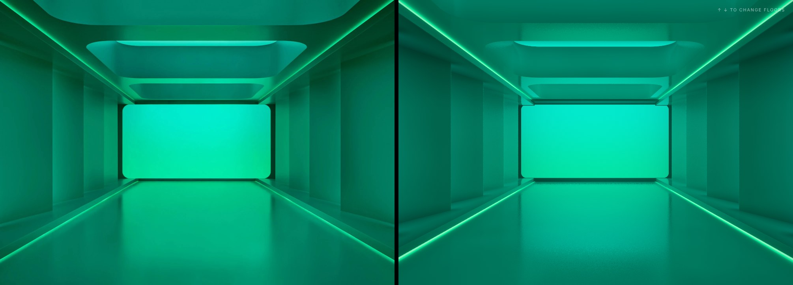
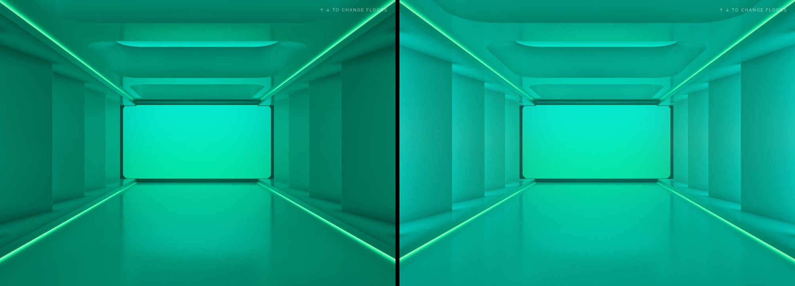
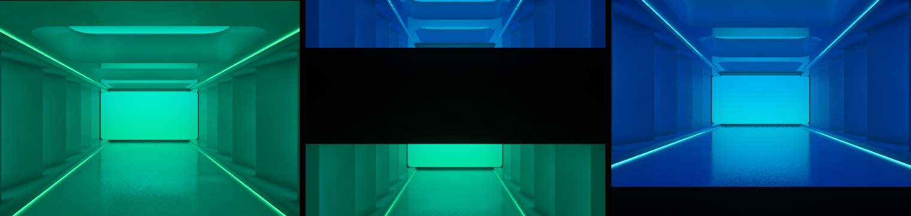

# Atrium Light Tower

A real-time, ray-traced WebGL2 recreation of the green light corridor, stacked into a building.
Every floor has the same set design and its own colour theme. You ride between floors with the
arrow keys, and each floor can be tuned from the control dock along the bottom edge.



## Run it

There is no build step and no dependencies. Either:

- open `index.html` directly in a desktop browser, or
- serve the folder with any static server, for example `python3 -m http.server`, then open
  <http://localhost:8000>.

It needs WebGL2 with floating-point render targets (`EXT_color_buffer_float`). Current Chrome,
Edge, Firefox and Safari 15+ all have this. A discrete GPU or a recent laptop GPU is recommended.
The renderer adapts its internal resolution to hold the frame rate. On slow GPUs it switches to
an analytic reflection fallback automatically.

## Controls

| Input | Action |
| --- | --- |
| `↑` / `↓` (or `PageUp` / `PageDown`) | Go up or down one floor |
| Floor numbers on the right edge | Jump to a floor |
| Vertical swipe (touch) | Change floor |
| `H` | Hide or show the interface |

The dock on the bottom edge edits **the floor you are on**:

- **Light intensity**: brightness of the end panel, LED lines and coffer lights (0–200 %).
- **Reflectiveness**: from matte to mirror-gloss (surface roughness and reflectance).
- **Atmosphere**: haze density, from crisp air to thick volumetric fog with light glow.
- **Room colour**: preset swatches or any custom colour. Wall paint, panel light, LED and
  coffer light colours are all derived from it.
- **Reset** (↺): restores the floor's defaults.

Settings are saved per floor in `localStorage`.

## The room

The geometry was measured from the reference image: the vanishing point, LED line slopes,
coffer corners and wall panel edges give a camera with a ~56° horizontal field of view. Scale is
set by a 1.6 m eye height.

- 5.56 m walkway with LED lines at the foot of the side ledges and at the ceiling bulkheads.
- Saw-tooth wall panels, each yawed ~16° towards the viewer, repeating every 2.41 m.
- Three deep (0.94 m) rounded coffers with a cove light along their far wall.
- A 6.8 × 3.4 m lightbox at the end, set in a dark reveal under a lintel.

### Wall slits

Each wall extension (the protruding far edge of a panel) hides a groove behind it with a
white light strip inside, facing down the corridor. The strips are never seen directly. You
see their light reflected off the next panel, the ledge and the glossy floor. They pulse together.

Each slit has an id (`slitId`, 0–11) and a `slitUV` on its strip, computed in `materialAt()` in
`js/shaders.js`. That is the hook for driving each slit from media later.



### Floors

Floors are stacked 5.2 m apart. Moving between them, the camera eases back out of the room, so
the trip reads as a cut-away section of the building.



## How the lighting works

All rendering happens in fragment shaders (`js/shaders.js`). The scene is a signed distance field
and is sphere-traced every frame.

- **End panel**: rectangular area light (analytic form factor) with stochastic soft shadows.
- **LED strips**: closed-form line-light irradiance plus analytic, roughness-blurred reflections.
- **Slits**: directional area lights (wall-washer beams) inside the grooves.
- **Global illumination**: a multi-bounce irradiance probe volume per floor, ray traced on the
  GPU and refreshed when a floor's colour changes. The coffer cove lights reach the room through
  this volume.
- **Reflections**: one GGX (visible-normal) sample per pixel, ray traced. Floor and ceiling hits
  also carry an analytic second bounce, so the floor shows the ceiling's reflection of the panel.
- **Haze**: single scattering from every light, ray-marched along the view ray.
- **Temporal accumulation**: static light and slit light are accumulated separately and recombined
  each frame. The pulse and the intensity slider therefore never smear or add noise.
- Bloom, then a hue-preserving filmic tone curve.

## Files

```
index.html        markup for the canvas, loader, elevator and dock
css/style.css     interface styles
js/shaders.js     all GLSL: scene, lights, GI probes, haze, TAA, bloom, tone mapping
js/gl.js          WebGL2 helpers (programs, float render targets)
js/renderer.js    pass orchestration, probe scheduling, camera framing
js/floors.js      floor themes, colour derivation, persistence
js/app.js         elevator navigation, controls, adaptive resolution, render loop
```

### Debug URL parameters

`?debug=1..7` shows albedo, normals, direct light, GI, reflections, AO or panel visibility.
`?scale=0.5` fixes the internal resolution. `?quality=low|high` forces a rendering path.
`?floor=3` sets the start floor. `?haze=0.8`, `?reflect=1` and `?intensity=1.5` override
settings. `?time=1.6` freezes the clock.
